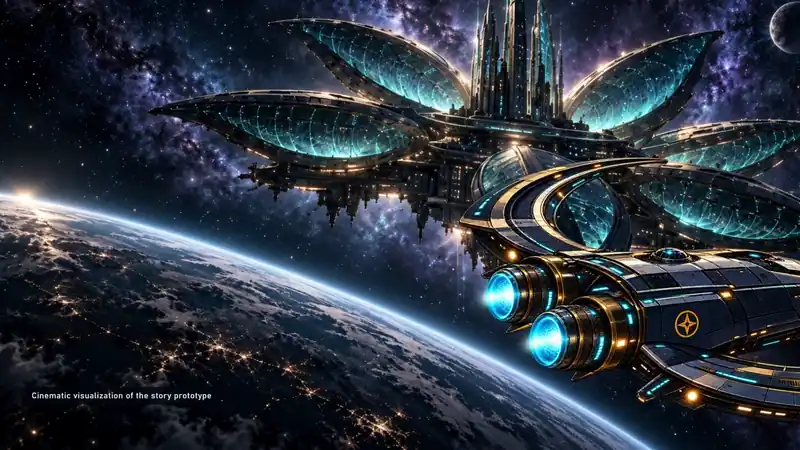
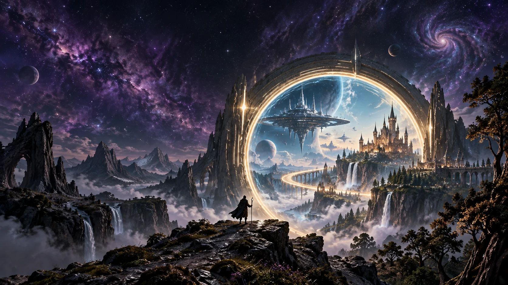

<p align="center">
  <a href="https://youtu.be/ErZVbIhhfho">
    
  </a>
</p>

<p align="center"><a href="https://youtu.be/ErZVbIhhfho"><strong>Watch the 60-second demo with sound on YouTube</strong></a></p>

<p align="center"></p>

<h1 align="center">PlotTwist by Futurelab Studios</h1>

<p align="center"><strong>Every choice opens a new chapter. Play to explore. Work to grow.</strong></p>

<p align="center"><em>A personalized storytelling and learning platform where your decisions move the story—and your skills—forward.</em></p>

<p align="center">
  <a href="https://plottwistbyfuturelab.netlify.app/"></a>
  <a href="https://plottwistbyfuturelab.netlify.app/#work"></a>
  <a href="https://plottwist-borrowed-stars.futurelabstudios.chatgpt.site/"></a>
</p>

<p align="center">
  
  
  
  
  
  
</p>

<p align="center"><a href="https://github.com/futurelabstudios/plottwist/actions"></a> &nbsp; <a href="https://github.com/futurelabstudios/plottwist"></a></p>

---

## ✨ What is PlotTwist?

**PlotTwist by Futurelab Studios** is a personalized storytelling and learning platform. **Play** offers interactive sci-fi and fantasy adventures; **Work** helps students and professionals upskill through story-based experiences.

### The solution

Users direct what happens next through voice, text, or guided choices—shaping their stories and learning through decisions, consequences, and practice.

### Two ways to grow

| 🚀 **PLAY** | 🧠 **WORK** |
| --- | --- |
| Explore illustrated sci-fi and fantasy worlds. Make choices, shift the plot, and discover a different ending. | Build practical skills through short, guided scenarios. Make a decision, see its effect, and practise what you learned. |
| **For curious readers and storytellers** | **For students and professionals** |

### The story loop

**Step into a situation** → **Choose your next move** → **See what changes** → **Learn, continue, or try another path**

## 🧭 Jump to a section

- [How it works](#how-the-experience-works)
- [Play: sci-fi and fantasy stories](#play-become-part-of-the-story)
- [Work: practical learning journeys](#work-learn-by-deciding-what-happens-next)
- [Run it locally](#run-locally)
- [OpenAI integrations](#openai-integration)
- [Project links](#project-links)

## 🎲 How the experience works

1. **Choose a world or a skill.** Enter Play for a story, or Work for a learning scenario.
2. **Step into the situation.** Read the scene, understand the stakes and take a role in it.
3. **Make your move.** Choose an action. In the sci-fi comic, you can also type or speak your own order and review it before confirming.
4. **See the consequence.** The next scene responds to your decision. A story can take a different direction; a learning scenario shows what your action would cause.
5. **Keep going.** Read the next chapter, try another approach or apply what you learned in a short exercise.

The wider product vision is to make reading and upskilling feel like participating in a story. The initial release demonstrates that format with authored branching stories, OpenAI-assisted comic dialogue, and short decision-led learning scenarios.

## 🚀 Play: become part of the story

Play contains illustrated stories that readers can direct. The reader’s name becomes part of the narrative, and choices carry consequences into later scenes.

### The Borrowed Stars — sci-fi

You command the _Wayfarer_. A space station has preserved 400 people as memories, and they want to leave. Rescue, consent and the station’s own intentions pull your crew in different directions. Your orders decide how the rescue unfolds.

- Ten pages, each with four illustrated panels.
- Four approaches at each of nine decision points: diplomacy, rescue, discovery and protection.
- Decisions affect crew trust, ship energy, the station’s bond, later dialogue and one of four endings. Mixed paths resolve by the most-used approach, with the latest decision breaking ties.
- Your Captain’s name follows you through the dialogue.
- Choose a suggested action, type an original order, or use voice transcription. Review the order before turning the page.
- A paper comic presentation with an opening animation, page folds and previous-page navigation.
- A complete authored edition that works without an API key, plus an OpenAI edition that adapts dialogue to your orders while preserving the story’s main events.
- Optional AI illustrations, saved progress, JSON story export and printing of visited pages.

### The Last Ember — fantasy

A city sleeps beneath two moons. A dragon guards a fading ember, and the legend about it leaves out something important. Your name and decisions help determine whether the city sees another dawn.

- A complete three-page short, with four panels per page.
- Two decision points, each offering four approaches.
- Four endings, with the first decision remembered in the resolution.
- Authored, local interactions; click to direct the story and replay a different path.

The fantasy short is the second example of the shared format. Its current illustrations use different crops of the portal artwork; a dedicated scene library can expand with the story catalog.

## 🧠 Work: learn by deciding what happens next

Work brings the same storytelling format into upskilling. Each course places you in a practical situation, asks for your next move and shows a consequence. A debrief explains the skill behind that decision, and an exercise lets you apply it to your own work.

For example, an AI productivity scenario begins with a team that needs a presentation draft. You decide how to brief the AI assistant, how to check an unsupported claim, and how to improve the draft. Each step teaches a skill as the scenario moves forward.

The current course library contains three short learning journeys:

| Course                            | Scenario and skills                                                                                         | Format                        |
| --------------------------------- | ----------------------------------------------------------------------------------------------------------- | ----------------------------- |
| **Make AI your thinking partner** | Help a team prepare a useful draft: write a clear brief, verify claims and iterate with specific feedback   | 3 chapters · about 12 minutes |
| **Tell stories that move people** | Prepare an interactive story for a showcase: create personal stakes, meaningful choices and an earned twist | 3 chapters · about 15 minutes |
| **Communicate with confidence**   | Coordinate a project launch: make a clear request, report concrete progress and give useful feedback        | 3 chapters · about 10 minutes |

Each chapter contains a situation, three decisions with distinct consequences, a skill explanation and a practice prompt. Productive choices unlock the next chapter; other choices explain the consequence and let you try again. Completion and practice notes save on the current browser.

These are authored starter scenarios. Longer learning paths, open-ended answers, AI coaching, formal assessments and certificates are future scope.

## ✨ The platform experience

The landing page introduces both sides of PlotTwist by Futurelab Studios with a cinematic portal connecting sci-fi and fantasy worlds. It includes pointer-responsive depth, animated orbits, floating labels, stars, scroll reveals, moving typography and interactive cards. Work’s visual language uses orbiting learning icons and clear scenario progression.

The experience supports desktop and mobile layouts, keyboard navigation, native dialogs and reduced-motion preferences. The sci-fi comic keeps its established paper-and-panel visual language when launched from the platform. Existing saved books can be resumed from the Play section.

## ✅ What is implemented today

- The PlotTwist by Futurelab Studios landing page, Play and Work catalog, and working experience launchers.
- The complete ten-page sci-fi comic and three-page fantasy short.
- Three courses with nine decision-led chapters, consequences, debriefs and exercises.
- Server-only OpenAI integration for the sci-fi story’s decisions, dialogue, recorded voice, Realtime transcription signaling and optional images.
- Browser-local persistence for the sci-fi book, generated art and learning progress.
- Netlify frontend/backend deployment, a ChatGPT Sites frontend that uses the same backend, and GitHub CI.

Accounts, cross-device saves, a content-authoring studio, paid enrollment, classroom management, certificates, a large story/course catalog and AI coaching in Work are planned extensions. They are not part of the current release.

## 🛠️ Run locally

Requires Node.js 24 and npm.

```sh
npm ci
cp .env.example .env # fresh checkout only; preserve an existing .env
# Add your OpenAI API key to .env
npm run dev:full
```

Open **http://localhost:8888** for the frontend and backend together. Restart the development server after changing `.env`.

`npm run dev` serves the frontend at port 5173. Play’s authored stories and Work’s courses function without an OpenAI key. The sci-fi story’s live dialogue, voice and image generation need the configured backend.

The actual local `.env` is ignored by Git. Never put the API key in a `VITE_` variable or frontend code.

## 🤖 OpenAI integration

The shared handler in `server/api.ts` runs locally and in Netlify Functions. The browser receives feature availability and results; the API key remains on the server.

| Endpoint                       | Purpose                                                                                   |
| ------------------------------ | ----------------------------------------------------------------------------------------- |
| `GET /api/config`              | Report available features without exposing secrets                                        |
| `POST /api/interpret-decision` | Use the Decisions API to map an order to one of four approaches, or request clarification |
| `POST /api/generate-story`     | Use the Responses API to return schema-validated, personalized panels                     |
| `POST /api/transcribe`         | Transcribe recorded audio                                                                 |
| `POST /api/realtime-session`   | Mediate the WebRTC SDP exchange for Realtime transcription                                |
| `POST /api/generate-art`       | Generate an optional four-panel illustration atlas with the Images API                    |

`.env.example` documents the model and feature switches. `OPENAI_ENABLE_LIVE=true` and an API key enable local live features. Hosted live access also requires `OPENAI_ALLOW_PUBLIC_LIVE=true`.

Netlify applies a limit of 20 API requests per minute per IP/domain. The handler validates payloads, applies timeouts and checks request origins. Hosted OpenAI use consumes the configured account’s quota; the initial release has no per-user credit ledger.

Recorded voice sends up to 15 seconds of audio to OpenAI. Transcripts are editable before confirmation. Live smoke checks have exercised Decisions, Responses, recorded transcription and image generation. Realtime signaling is implemented and covered by mocked tests; a real browser microphone/WebRTC session still needs device validation.

## 💾 Persistence

- **Sci-fi book:** localStorage on the current browser, with schema validation when restoring.
- **Generated illustrations:** IndexedDB on the current browser.
- **Work:** localStorage for completed chapters and practice notes.
- **Fantasy short:** current session state; restarting gives you a fresh path.

Sci-fi JSON exports contain the story text and decisions, not generated image data. There is no cloud account or cross-device synchronization in this release.

## 🌐 Project links and deployment

| Resource | Link |
| --- | --- |
| 🌐 **Live app** | [plottwistbyfuturelab.netlify.app](https://plottwistbyfuturelab.netlify.app/) |
| 💬 **ChatGPT Site** | [Open PlotTwist](https://plottwist-borrowed-stars.futurelabstudios.chatgpt.site/) |
| 💻 **Source code** | [github.com/futurelabstudios/plottwist](https://github.com/futurelabstudios/plottwist) |
| 🎥 **YouTube** | [Watch the PlotTwist cinematic demo](https://youtu.be/ErZVbIhhfho) |
| 📊 **Explainer deck** | [PlotTwist-explainer-deck](https://docs.google.com/presentation/d/12D6AWENRo8JqOl7xpxU8AYufs0dQ3YHyqOUTDjoo7Hg/edit?usp=sharing) |

**Project:** PlotTwist by Futurelab Studios · **Built by:** Futurelab Studios

Netlify serves the built React frontend and the API. After authenticating and linking the Netlify CLI:

```sh
npm run build
npx netlify deploy --prod --no-build --dir dist --functions netlify/functions
```

Set `OPENAI_` variables in the production **Functions** environment. `scripts/configure-netlify.mjs` can transfer `.env` values through the authenticated CLI account without printing them. It enables hosted live access; the local file stays ignored.

ChatGPT Sites uses a separate, ignored Vinext checkout in `hosting/chatgpt`. Its worker forwards `/api/*` to Netlify, keeping one server-side OpenAI key. `node scripts/sync-sites.mjs` updates shared code and assets in that initialized checkout; publish it with the Sites plugin’s source/build/archive workflow.

Both hosts are manually published. GitHub Actions validates pushes; it does not automatically redeploy either host.

## 🧪 Development and checks

```sh
npm run typecheck
npm run lint
npm test
npm run build
node scripts/smoke-local.mjs # exercises configured local live APIs
```

Tests cover sci-fi routes and saves, fantasy branches and name continuity, learning-content decision invariants, API boundaries and schema failures, decision confidence, audio/image endpoints and microphone cleanup.

```text
src/platform/Platform.tsx   PlotTwist by Futurelab Studios landing page, catalog, fantasy reader and learning player
src/platform/Platform.css  Hero, motion, responsive layouts and dialogs
src/platform/content.ts    Fantasy story and authored learning scenarios
src/App.tsx                Existing sci-fi comic and its interaction state
src/lib/story.ts           Ten-page sci-fi story, branches and saved book schema
src/lib/voice.ts            Recording and Realtime lifecycle
src/lib/art-cache.ts        Optional generated illustration persistence
server/api.ts              Validated server-only OpenAI integrations
netlify/functions/api.mts  Netlify adapter and rate limit
public/art/                Portal artwork and comic illustration atlases
scripts/                   Local development, smoke checks and hosting helpers
```

See [the comic’s visual direction](docs/visual-direction.md) and [the platform’s hero artwork](docs/plottwist-art.md) for the illustration system and generation prompt.

---

<p align="center"><strong>PlotTwist by Futurelab Studios</strong><br/><em>Your next chapter starts with you.</em></p>

<p align="center">
  <a href="https://plottwistbyfuturelab.netlify.app/">
    
  </a>
</p>
